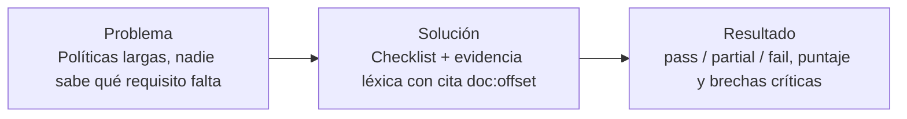

<div align="center">

# doc-compliance-local

**Verificador de cumplimiento documental** · Angel Salazar

`checklist + documentos → evidencia citada o brecha → puntaje`

</div>

---

### `$ cat diagrama.md`



---

### `$ cat problema.md`

Una auditoría pide 14 controles y los documentos están repartidos en varios archivos.  
Cada requisito se busca en el corpus, se cita el pasaje exacto o se marca como brecha. Todo local, sin LLM.

---

### `$ ./check.sh`

```bash
python -m venv .venv
.venv\Scripts\activate
pip install -e .
pytest
python -m doc_compliance check --checklist samples/checklist/security_baseline.json --docs samples/docs_ok
python -m doc_compliance compare
python -m doc_compliance history
python -m doc_compliance serve
```

UI: http://127.0.0.1:8022

Salida: `results/compliance_report.md`, `results/compliance_report.json` y `results/history.db`.

---

### `$ cat checklist.md`

```json
{
  "id": "SEC-02",
  "title": "Multi-factor authentication",
  "critical": true,
  "weight": 3,
  "keywords": ["authenticator", "hardware token|security key|totp"],
  "must_have": ["multi-factor authentication|mfa", "all remote access|administrative access"]
}
```

- `must_have`: frases obligatorias; `|` separa alternativas equivalentes.
- `keywords`: términos de apoyo.
- Puntaje por requisito: 65% `must_have` + 35% `keywords`. `pass` exige todas las frases y al menos la mitad de las keywords; bajo 35% es `fail`.
- Puntaje global ponderado por `weight`. Brecha crítica: requisito `critical` que no es `pass`.
- Una frase precedida por una negación ("we do not enforce MFA") no cuenta como evidencia y se muestra como contra-evidencia.

---

Hecho en Lima · Angel Salazar · CIP 404730
