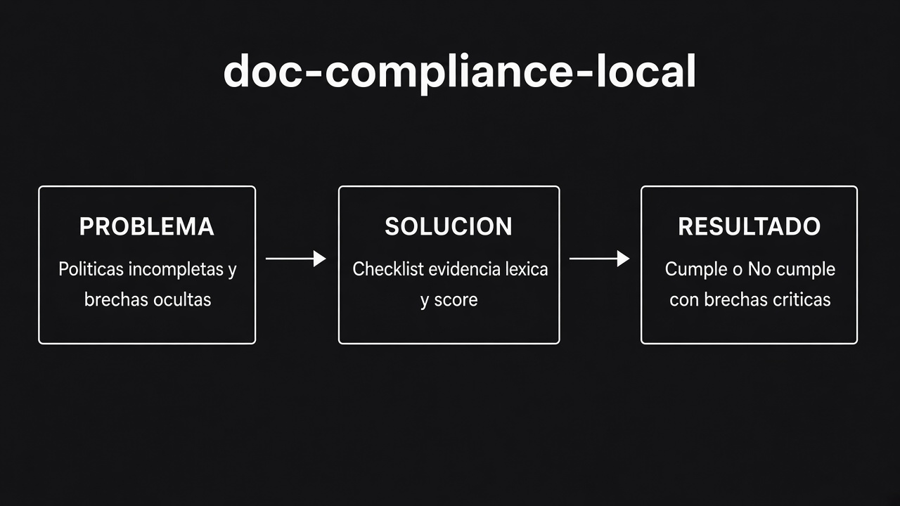
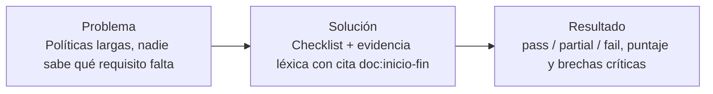

<div align="center">

# doc-compliance-local

**Verificador de cumplimiento documental** · Angel Salazar Lima · CIP 404730

`checklist + documentos → evidencia citada o brecha → puntaje`


<br/>


</div>

---

### `$ cat diagrama.md`



Arquitectura completa y diagrama de referencia en AWS: [docs/architecture.md](docs/architecture.md).

---

### `$ cat problema.md`

Una auditoría pide 14 controles y los documentos están repartidos en varios archivos.  
Cada requisito se busca en el corpus, se cita el pasaje exacto o se marca como brecha. Todo local, sin LLM.

---

### `$ cat resultados.md`

Experimento sobre el checklist *Security Baseline* (14 requisitos, 6 críticos):

| Corpus | Puntaje | Veredicto | pass / partial / fail | Brechas críticas |
|---|---|---|---|---|
| `docs_ok` | 98.9% | Cumple | 13 / 1 / 0 | 0 |
| `docs_gap` | 11.7% | No cumple | 0 / 2 / 12 | 6 (SEC-01, 02, 04, 05, 07, 08) |

Los corpus son sintéticos; miden que el motor funciona como se diseñó, no su exactitud sobre políticas reales.
Detalle en [docs/EXPERIMENT.md](docs/EXPERIMENT.md) y [docs/CONCLUSIONS.md](docs/CONCLUSIONS.md).

---

### `$ ./check.sh`

```bash
python -m venv .venv
.venv\Scripts\activate          # Linux/macOS: source .venv/bin/activate
pip install -e ".[dev]"
pytest
python -m doc_compliance check --checklist samples/checklist/security_baseline.json --docs samples/docs_ok
python -m doc_compliance compare
python -m doc_compliance history
python -m doc_compliance serve
```

Salida: `results/compliance_report.md`, `results/compliance_report.json`, `results/compliance_report.html` (con `--html`) y `results/history.db`.

`check --fail-under 80` devuelve código 1 si el puntaje es menor, útil como compuerta en CI.

---

### `$ docker compose up`

```bash
docker compose up --build
```

Consola en http://127.0.0.1:8022. El historial y los reportes persisten en el volumen `compliance-results`. El contenedor corre como usuario sin privilegios y expone `/api/health` como healthcheck.

Sin compose:

```bash
docker build -t doc-compliance-local .
docker run --rm -p 8022:8022 doc-compliance-local
```

---

### `$ cat ui.md`

La consola web (puerto 8022) tiene panel lateral y cuatro vistas:

- **Panel**: KPIs de puntaje global, brechas críticas, documentos procesados y actividad reciente; estado por requisito y puntaje por categoría.
- **Evaluar documentos**: muestras, rutas locales o archivos subidos.
- **Requisitos y evidencia**: matriz requisito × documento con las citas.
- **Historial**: corridas guardadas en SQLite.

API: `POST /api/check`, `GET /api/history`, `GET /api/history/{id}`, `GET /api/history/{id}/html`, `GET /api/samples`, `GET /api/health`.

---

### `$ cat ci.md`

`.github/workflows/ci.yml` ejecuta en cada push y pull request:

1. `pytest` en Python 3.10 y 3.12.
2. `doc_compliance compare` como prueba de humo del experimento.
3. Construcción de la imagen y comprobación de `/api/health` en el puerto 8022.

---

### `$ cat checklist.md`

```json
{
  "id": "SEC-02",
  "title": "Multi-factor authentication",
  "critical": true,
  "weight": 3,
  "keywords": ["authenticator", "hardware token|security key|totp"],
  "must_have": ["multi-factor authentication|mfa", "all remote access|administrative access"]
}
```

- `must_have`: frases obligatorias; `|` separa alternativas equivalentes.
- `keywords`: términos de apoyo.
- Puntaje por requisito: 65% `must_have` + 35% `keywords`. `pass` exige todas las frases y al menos la mitad de las keywords; bajo 35% es `fail`.
- Puntaje global ponderado por `weight`. Brecha crítica: requisito `critical` que no es `pass`.
- Una frase precedida por una negación ("we do not enforce MFA") no cuenta como evidencia y se muestra como contra-evidencia.

---

### `$ tree`

```
src/doc_compliance/   checklist · corpus · evidence · scorer · report · store · cli · web
samples/              checklist y corpus docs_ok / docs_gap
tests/                pytest
docs/                 architecture · EXPERIMENT · CONCLUSIONS
Dockerfile · docker-compose.yml · .github/workflows/ci.yml
```

---

Hecho en Lima · Angel Salazar Lima · CIP 404730
