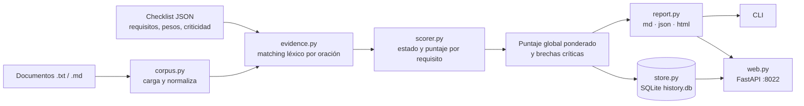
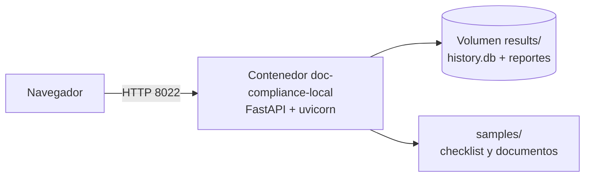
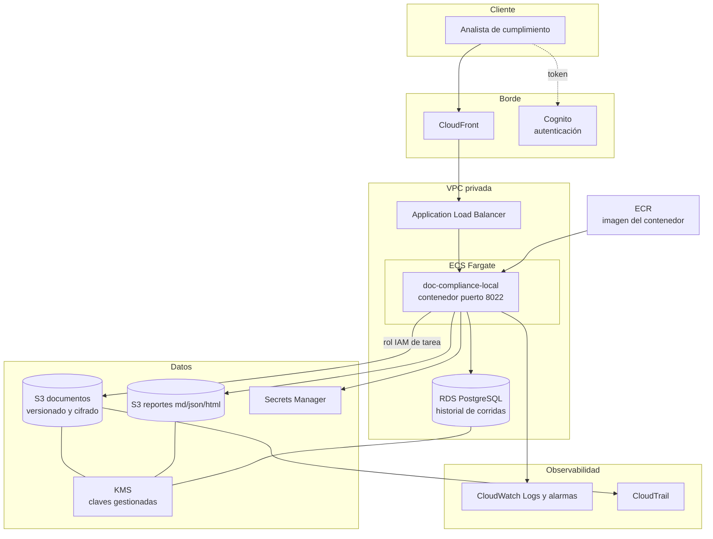

# Arquitectura

Autor: Angel Salazar Lima · CIP 404730

`doc-compliance-local` evalúa un conjunto de documentos contra un checklist de requisitos. El flujo es determinista y no usa LLM: **checklist → evidencia → puntaje → brechas**.

## Flujo de datos



| Etapa | Módulo | Entrada | Salida |
|---|---|---|---|
| Checklist | `checklist.py` | JSON con `id`, `title`, `critical`, `weight`, `keywords`, `must_have` | `Checklist` con `Requirement` inmutables |
| Corpus | `corpus.py` | Carpeta, archivo o textos subidos | Lista de `Document` |
| Evidencia | `evidence.py` | `Requirement` + documentos preparados | `Evidence` con cita `doc:inicio-fin`, frases halladas y negadas |
| Puntaje | `scorer.py` | Resultado de evidencia por requisito | `RequirementResult` y `ComplianceRun` |
| Reportes | `report.py` | `ComplianceRun` | `compliance_report.md/.json/.html` |
| Historial | `store.py` | `ComplianceRun` | Tabla `runs` en SQLite |
| Interfaces | `cli.py`, `web.py` | Argumentos / HTTP | Resumen en consola, API REST y consola web |

## 1. Checklist

Cada requisito declara:

- `must_have`: frases obligatorias. `|` separa alternativas equivalentes (`tls 1.2|tls 1.3`).
- `keywords`: términos de apoyo.
- `critical`: si el requisito no cumple, cuenta como brecha crítica.
- `weight`: peso en el puntaje global.

El checklist de muestra (`samples/checklist/security_baseline.json`) define 14 requisitos en cuatro categorías: Access, Data protection, Operations y Governance. Seis son críticos (SEC-01, 02, 04, 05, 07, 08).

## 2. Evidencia

1. Los documentos se dividen en oraciones con su posición de carácter.
2. Texto y términos se normalizan (minúsculas, sin acentos), de modo que `política` coincide con `politica`. Los términos admiten sufijos `s|es|ed|d|ing` y separadores espacio o guion.
3. Por cada oración se buscan `must_have` y `keywords`.
4. Si la frase aparece tras una negación a menos de tres tokens ("we do not enforce MFA"), no suma como evidencia: se guarda como contra-evidencia.
5. Las evidencias positivas se ordenan por puntaje (2 por `must_have`, 1 por `keyword`) y se conservan hasta `max_evidence`, reservando un lugar a la contra-evidencia si existe.

Cada cita es verificable: `access_policy.txt:791-892` apunta al rango exacto de caracteres del documento original.

## 3. Puntaje

Por requisito, con cobertura = frases halladas / frases pedidas:

```
score = 0.65 * cobertura(must_have) + 0.35 * cobertura(keywords)
```

| Estado | Condición |
|---|---|
| `pass` | todas las `must_have` y al menos 50% de las `keywords` |
| `fail` | no es `pass` y `score < 0.35` |
| `partial` | cualquier otro caso |

Si un requisito no tiene `keywords` o no tiene `must_have`, el puntaje usa solo el componente disponible (umbral de pass: 100% de `must_have`, o 75% de `keywords`).

Puntaje global: promedio de `score` ponderado por `weight`.

| Veredicto | Condición |
|---|---|
| `compliant` | global ≥ 80% y ninguna brecha crítica |
| `non_compliant` | global < 60% o algún requisito crítico en `fail` |
| `needs_work` | cualquier otro caso |

## 4. Brechas

Una brecha es todo requisito en estado distinto de `pass`. Es **brecha crítica** si además el requisito es `critical`. El reporte lista, por brecha, las frases obligatorias ausentes, las solo negadas y las keywords ausentes, para que el responsable sepa qué texto falta en la política.

`doc-compliance check --fail-under N` devuelve código 1 si el puntaje es menor que `N`, lo que permite usarlo como compuerta en CI.

## Despliegue local



`docker compose up --build` expone la consola en `http://127.0.0.1:8022`. El endpoint `/api/health` sirve de healthcheck.

## Diagrama de referencia en AWS

Referencia conceptual para llevar la herramienta a una cuenta propia. No está desplegado, no hay identificadores de cuenta ni credenciales; los nombres son genéricos. Las credenciales deben provenir de roles IAM y de Secrets Manager, nunca del repositorio.



Cambios necesarios respecto a la versión local:

| Aspecto | Local | AWS |
|---|---|---|
| Documentos | Carpeta o subida web | Bucket S3 versionado con cifrado KMS |
| Historial | SQLite (`results/history.db`) | RDS PostgreSQL; requiere adaptar `store.py` |
| Autenticación | Ninguna (solo `127.0.0.1`) | Cognito delante del ALB |
| Secretos | No hay | Secrets Manager y rol IAM de la tarea |
| Logs | Salida de uvicorn | CloudWatch Logs |
| Imagen | `docker build` local | ECR |

## Límites conocidos

- El matching es léxico: no entiende sinónimos fuera de los declarados ni el contexto semántico. Una frase presente en un documento puede cumplir el checklist aunque la política no se aplique en la práctica.
- Solo se leen `.txt` y `.md`.
- La detección de negación mira una ventana corta de tokens; construcciones largas pueden escaparse.
- La consola web no tiene autenticación y está pensada para uso local.
